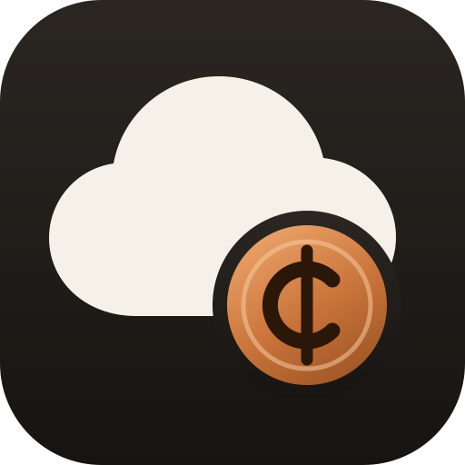
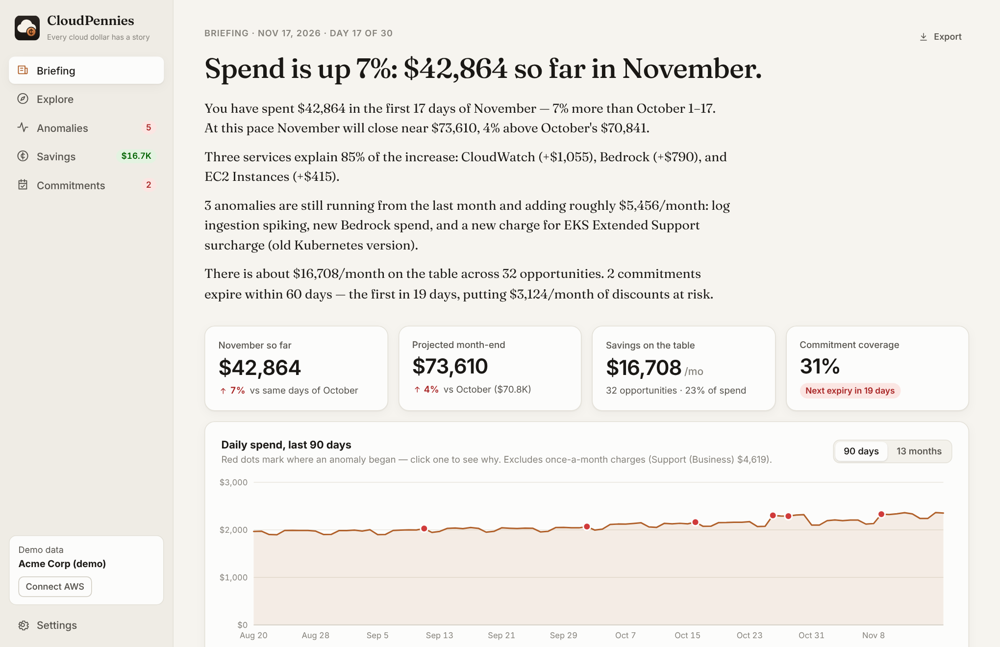
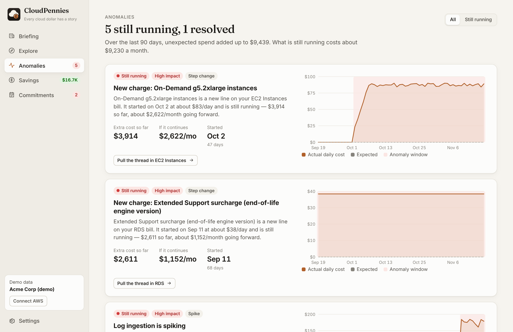
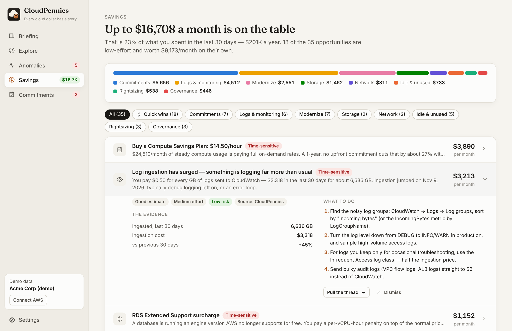
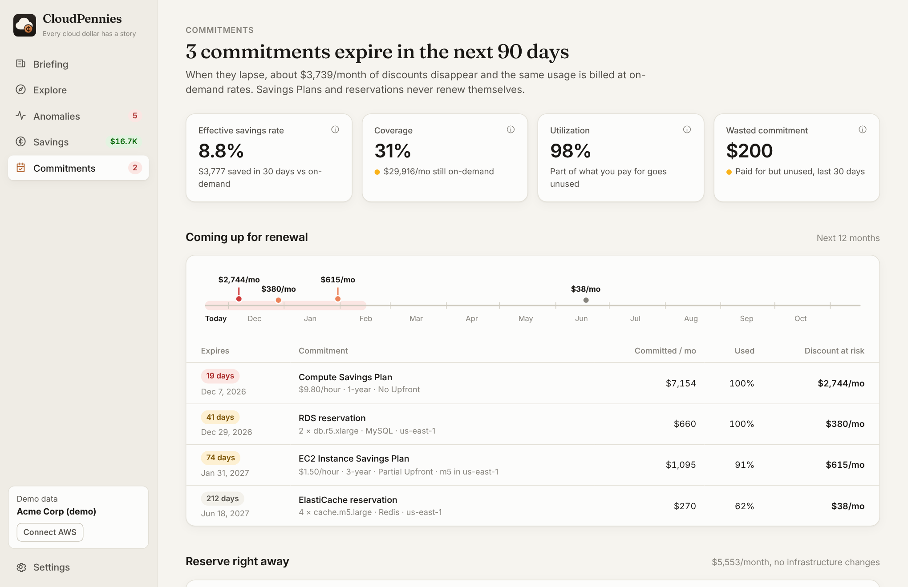
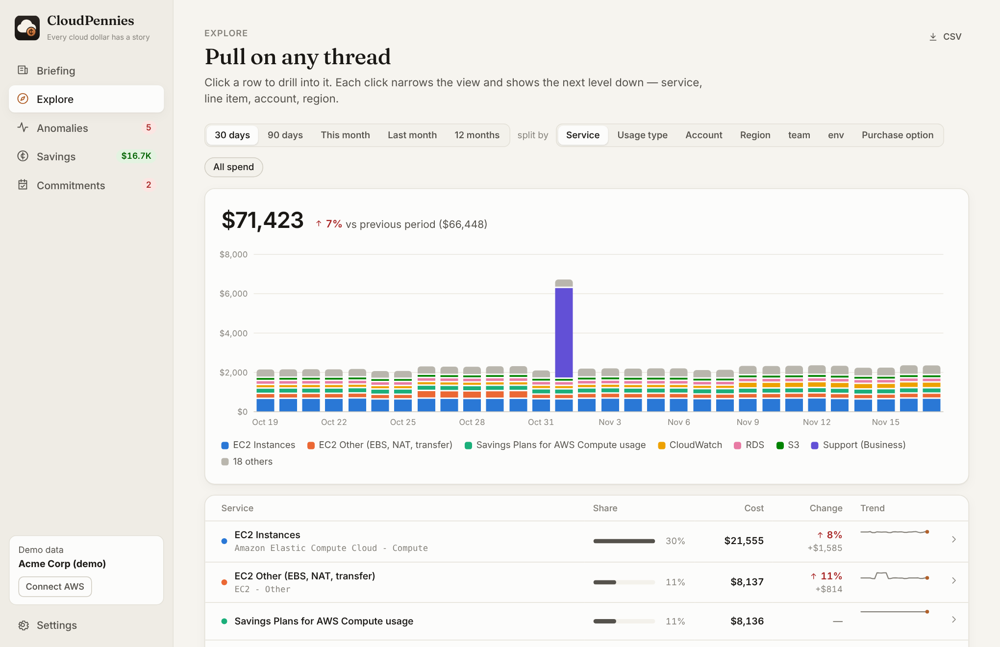

<p align="center">
  
</p>

<h1 align="center">CloudPennies</h1>
<p align="center"><i>Every cloud dollar has a story.</i></p>

CloudPennies is a desktop app (macOS, Linux, Windows) that reads your AWS bill with a read-only key and tells you, in plain language, where the money goes, what changed, and what to do about it.

It is built for someone who owns an AWS bill and has ten minutes, not an afternoon.



## What it does

| Screen | The question it answers |
|---|---|
| **Briefing** | "What happened to my bill, in four sentences?" Month-to-date, projected month-end, the services that moved and *which line item* moved them, and the three or four things to do first. Exports to Markdown for Slack or email. |
| **Explore** | "Where exactly is this money going?" Click any row to drill down: service → usage type → account → region → tag. AWS's cryptic usage types (`USE1-NatGateway-Bytes`) are translated to English ("NAT Gateway data processing"). CSV export. |
| **Anomalies** | "Did anything break pattern?" Spikes, silent step-ups that never came back down, and brand-new services — each with the dollar impact, a monthly run-rate if it continues, and the usage types responsible. Every anomaly also comes with a copy-paste **investigation prompt** for Claude Code: a strictly read-only brief (anomaly facts, ready-to-run Cost Explorer commands, service-specific steps) for finding the root cause. |
| **Savings** | "What can I cut?" A ranked list with a dollar figure, effort, risk, and how firm the estimate is. Each item expands into the evidence, the exact resources, and the steps to fix it. |
| **Commitments** | "What should I reserve right now, and what is about to expire?" Effective savings rate, coverage, utilization, a 12-month renewal calendar with the discount at risk, and AWS's purchase recommendations with cautious buying advice. |

<table>
<tr>
<td></td>
<td></td>
</tr>
<tr>
<td></td>
<td></td>
</tr>
</table>

### Beyond the five screens

- **Can I trust these numbers?** Every scan checks itself: the same month must total the same by service, usage type, account and region. Settings shows the checks, the exact figures to compare with Cost Explorer, and a button that opens the matching console view. An incomplete latest day is detected and left out of trends.
- **Whole-organization resource scan.** Give CloudPennies the name of a read-only role that exists in each member account and it assumes that role to inspect every account, not only the one the key belongs to. See [`docs/MEMBER_ROLE.md`](docs/MEMBER_ROLE.md).
- **Scheduled scans and alerts.** Rescans on a schedule while running (optionally from the menu bar or tray), with desktop notifications for new anomalies, commitments approaching expiry and new opportunities. Optional Slack webhook for alerts and a Monday digest.
- **Progress tracking.** Each scan is remembered. Opportunities that disappear are counted as resolved savings, with a trend of what is still on the table.
- **Purchase planner.** On the Commitments page: a savings curve across every Savings Plan commitment level, with safe, best-fit and AWS-recommended points, a usage-drop stress test, how far usage can fall before a plan stops paying off, and the effect of plans that are about to expire.
- **Cost by resource, with history.** CloudPennies imports your Cost and Usage Report from S3 (Data Exports / CUR 2.0 or legacy, Parquet or CSV) and keeps a compact summary locally, so Explore can split any view by individual resource for whole months. Without a report it falls back to Cost Explorer's last 14 days. See [`docs/CUR.md`](docs/CUR.md).

### What it looks for

Findings come from three tiers of evidence. A stronger tier suppresses the weaker one for the same topic, so nothing is counted twice.

1. **AWS's own engines** — Cost Optimization Hub (which includes Compute Optimizer), Cost Explorer rightsizing, and Savings Plan / Reserved Instance purchase recommendations.
2. **An optional read-only resource scan** — CloudWatch dashboards nobody has opened in 90 days (checked against CloudTrail), log groups set to never expire, alarms stuck in `INSUFFICIENT_DATA`, unattached EBS volumes, snapshots older than a year, idle Elastic IPs, load balancers with no targets, long-stopped instances still paying for disks.
3. **Billing-data heuristics** that need nothing but Cost Explorer — RDS and EKS extended-support surcharges, log ingestion surges, log storage that only grows, `GetMetricData` polling by monitoring vendors, custom-metric sprawl, NAT Gateway data processing, cross-AZ transfer, gp2 volumes, previous-generation and non-Graviton instances, S3 data that never leaves Standard, duplicate CloudTrail trails, AWS Config churn, Lambda on x86, empty capacity reservations, T-family credit overages, under-used commitments, untagged spend.

Credits and refunds are excluded from every trend, so an expiring credit never looks like a spike.

## Try it without an AWS account

The app ships with a realistic demo account. Launch it and choose **Explore with demo data**.

```bash
npm install
```

```bash
npm run dev:app
```

To see the demo in a browser instead (no AWS connection possible there):

```bash
npm run dev
```

## Install

Download an installer from the [Releases](https://github.com/dominicplouffe/CloudPennies/releases) page once a version has been tagged, or build one yourself:

```bash
npm run dist:mac
```

```bash
npm run dist:linux
```

```bash
npm run dist:win
```

Installers land in `release/`. macOS builds must be made on a Mac; a ready-made GitHub Actions workflow builds all three platforms when you push a tag such as `v0.1.0`. To enable it, move the two files in `docs/github-workflows/` to `.github/workflows/`.

Builds are unsigned unless you add signing credentials; [`docs/SIGNING.md`](docs/SIGNING.md) explains how. An unsigned macOS build is blocked on first launch: open **System Settings → Privacy & Security** and choose **Open Anyway**. Unsigned macOS builds also cannot update themselves; the app offers a download link instead.

## Connecting your AWS account

You need Cost Explorer enabled (Billing → Cost Explorer) and an IAM user or role with the policy in [`docs/IAM_POLICY.json`](docs/IAM_POLICY.json). It is read-only and has two statements:

- `CloudPenniesBilling` — required. Cost Explorer, Budgets, Cost Optimization Hub.
- `CloudPenniesResourceScan` — optional. `Describe*`/`List*` calls for the resource scan. Leave it out and turn the scan off in Settings if you want a billing-only key.

In an AWS Organization, use a key from the management (payer) account to see every linked account.

For the richest recommendations, opt in to **Cost Optimization Hub** and **Compute Optimizer** once in the AWS console. Both are free.

You can connect with an access key or pick a profile from `~/.aws`.

### Privacy and cost

- Your key is encrypted with the operating system keychain (Electron `safeStorage`) and stored only on your computer. If you choose a profile, only its name is stored.
- CloudPennies has no server and no telemetry. It talks to AWS APIs, and packaged builds ask GitHub Releases whether a newer version exists (turn this off in Settings → About). The one exception is a Slack webhook, and only if you add one: it receives alert titles and dollar amounts.
- AWS charges $0.01 per Cost Explorer API request. A full scan typically makes 30–80 requests. Results are cached on disk, and the app shows the request count for every scan.

## How it works

```
electron/            main process: credentials, AWS collector, disk cache
  aws/               Cost Explorer queries, commitments, recommendations, resource scan
src/core/            pure TypeScript, no Node or DOM dependencies
  types.ts           the data model: Snapshot (facts) → Report (analysis)
  catalog.ts         usage-type and service-name dictionary
  analysis/          anomaly detection, savings insights, briefing narrative
  demo.ts            the demo account
src/ui/              React renderer
tests/               vitest
docs/RESEARCH.md     survey of existing cost tools and what was borrowed from each
```

A scan produces a `Snapshot` of normalized facts. `analyze(snapshot)` turns it into a `Report`. The demo account produces the same `Snapshot` shape, so the analysis and UI run identical code on demo and live data.

**Anomaly detection.** Each (service, usage type) series is compared with the median of its previous 28 days. A day is anomalous when it exceeds the baseline by more than 3.5 robust standard deviations *and* 25% *and* a dollar floor. Anomalous days do not contaminate the baseline; if the new level persists for 14 days it is reported as a step change and accepted as the new normal. Charges that recur monthly are ignored. AWS Cost Anomaly Detection findings are merged in when the account has monitors.

## Development

```bash
npm test
```

```bash
npm run typecheck
```

```bash
npm run demo-report
```

`demo-report` prints the full analysis of the demo account to the terminal — the quickest way to see the effect of a change to the engine.

## Status and limits

- Version 0.2. The collector is covered by unit tests with stubbed AWS clients and has had only limited use against live accounts; expect rough edges, check Settings → "Can I trust these numbers?", and report problems with the diagnostics button there. Sections that fail (missing permission, service not enabled) are skipped and listed in Settings rather than failing the scan.
- Savings marked "rough estimate" are inferred from billing data with stated assumptions. Treat them as leads, not quotes.
- The Cost and Usage Report reader is tested against generated Parquet and CSV files only, not real AWS exports. Tags are not imported from the report, and only the largest resources are kept individually.
- AWS only. Kubernetes cost allocation, unit economics, custom cost groupings and commitment what-if modelling are not built yet.
- Signing, notarization and macOS/Windows auto-update are configured but have never been exercised with real certificates. The purchase planner models daily usage and Compute Savings Plans only.

## License

MIT
